

  <a href="https://www.maxwellnixon.com"></a>

I'm Maxwell. By day I'm a technician at a managed IT provider in New Jersey, keeping law firms and courtrooms running, and I run IT for my family's tree service business on the side.

The rest of the time I build things, mostly to find out whether they can be built: game-engine experiments in C++, small Windows apps in C#, an Arch-based gaming distro, web platforms, and local AI. I like projects that cross boundaries, from rendering one GTA world inside another to making a useful desktop tool fit in a single small executable.

**Start here:** [Explore my portfolio](https://www.maxwellnixon.com) · [Browse my projects](https://www.maxwellnixon.com/projects) · [Try the browser tools](https://www.maxwellnixon.com/tools) · [GitLab](https://gitlab.com/Maxwell333)



## Live & public

These are the repos you can open without asking. GitLab still holds the private source.

| Project | What it does | Live |
| --- | --- | --- |
| [Meshlight](https://github.com/iM4x3ll/meshlight) | Interactive mesh map of my homelab fabric — edge, DNS, inference, media, and game servers as one glowing network. | [meshlight.vercel.app](https://meshlight.vercel.app) |
| [Homelab Pulse](https://github.com/iM4x3ll/homelab-pulse) | Public status board for the AI stack, DNS, media, and game servers at home. | [homelab-pulse.vercel.app](https://homelab-pulse.vercel.app) |
| [maxwellnixon.com](https://www.maxwellnixon.com) | Portfolio, 35+ browser tools, live data, and an arcade. | [site](https://www.maxwellnixon.com) |
| [CU7000 / Tizen notes](https://github.com/iM4x3ll/cu7000-tizen-notes) | Field notes from a working Samsung CU7000 living-room setup. | [repo](https://github.com/iM4x3ll/cu7000-tizen-notes) |


## What I build

Most of the source below is private on [GitLab](https://gitlab.com/Maxwell333). The [portfolio](https://www.maxwellnixon.com) is the public starting point.

| Project | What it does | Built with |
| --- | --- | --- |
| [XPort](https://gitlab.com/Maxwell333/xport) | Renders live GTA guest worlds inside San Andreas. Seamless portal traversal is still in development. | C++, Direct3D 9 |
| [MaxwellOS](https://gitlab.com/Maxwell333/maxwellos) | Personal Arch-based gaming distro with ISO build scripts and a Windows-to-VM workflow. | Arch Linux, Bash, PowerShell |
| [MAX Launcher](https://gitlab.com/Maxwell333/max-launcher) | Portable Windows game launcher with automatic discovery, artwork and controller navigation. | C#, WinForms |
| [Riftfall](https://gitlab.com/Maxwell333/riftfall) | Co-op extraction game: gather orbs, bank upgrades and escape a collapsing island. In private playtesting. | Luau, Roblox |
| [Powder Lab](https://gitlab.com/Maxwell333/powder-lab) | Falling-sand sandbox with particle physics, material reactions and a custom software renderer. | C#, WPF |
| [Paradise](https://gitlab.com/Maxwell333/paradise-radio) | Unofficial Radio Paradise player with lossless playback and a neural DJ voice. | Python, PyQt6, libVLC |
| [maxwellnixon.com](https://www.maxwellnixon.com) | Public portfolio, browser tools, live data and an arcade. | Next.js, TypeScript |

  <a href="https://gitlab.com/Maxwell333/xport">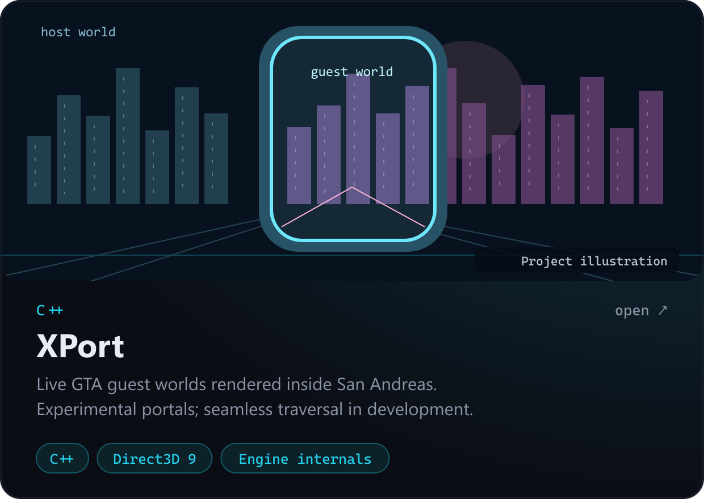</a>
  <a href="https://gitlab.com/Maxwell333/maxwellos">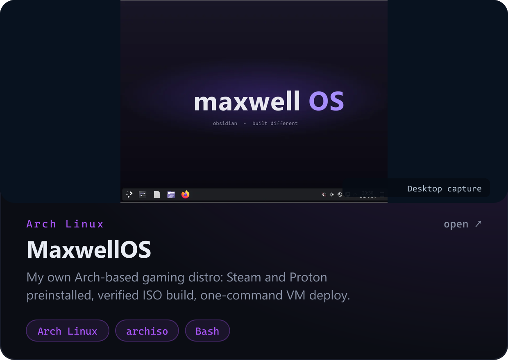</a>

  <a href="https://gitlab.com/Maxwell333/max-launcher">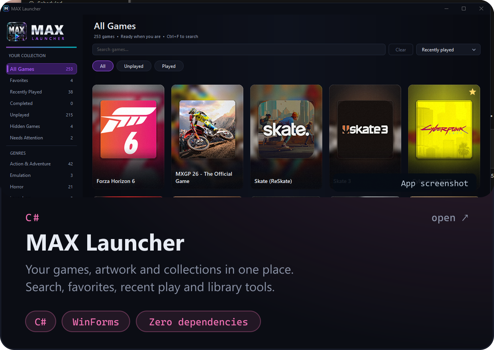</a>
  <a href="https://ouija.one">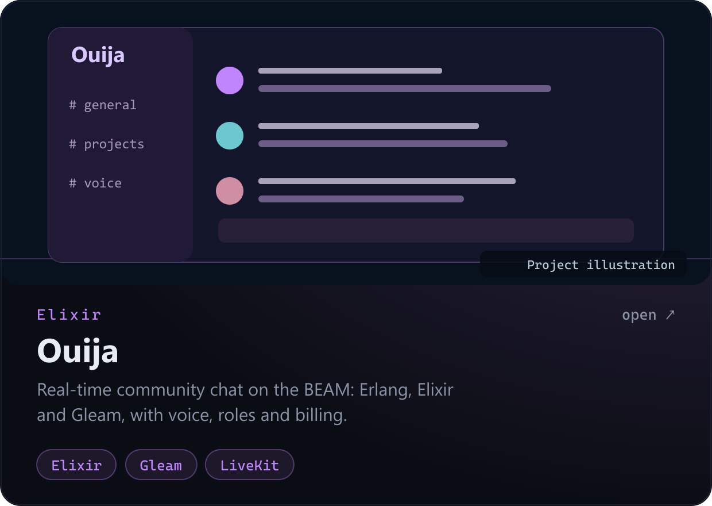</a>

  <a href="https://gitlab.com/Maxwell333/riftfall">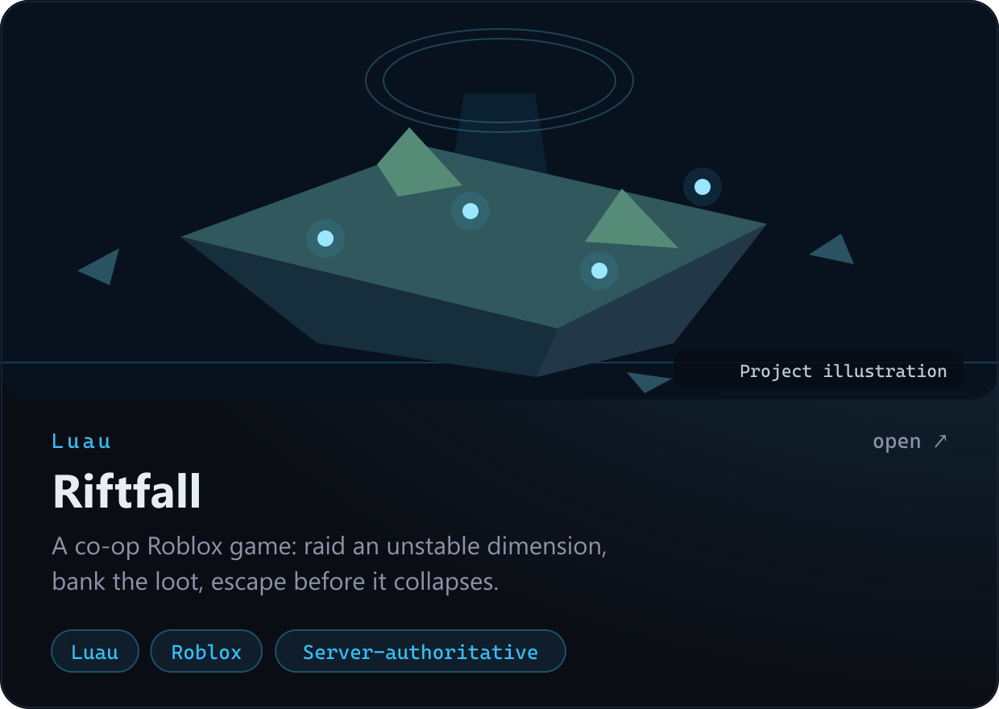</a>
  <a href="https://gitlab.com/Maxwell333/powder-lab">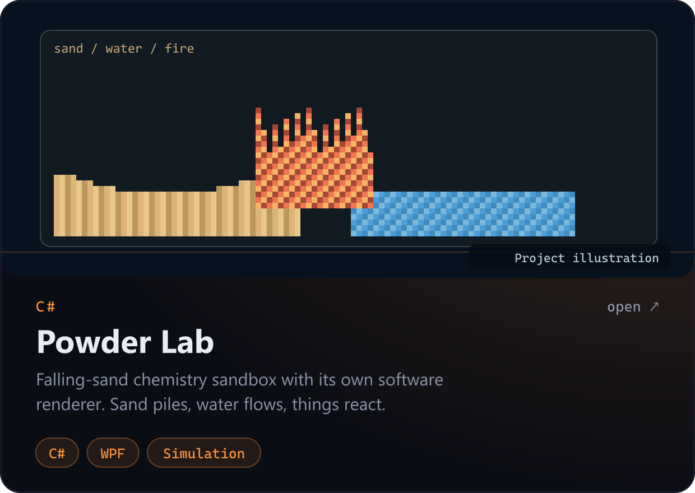</a>

  <a href="https://gitlab.com/Maxwell333/paradise-radio">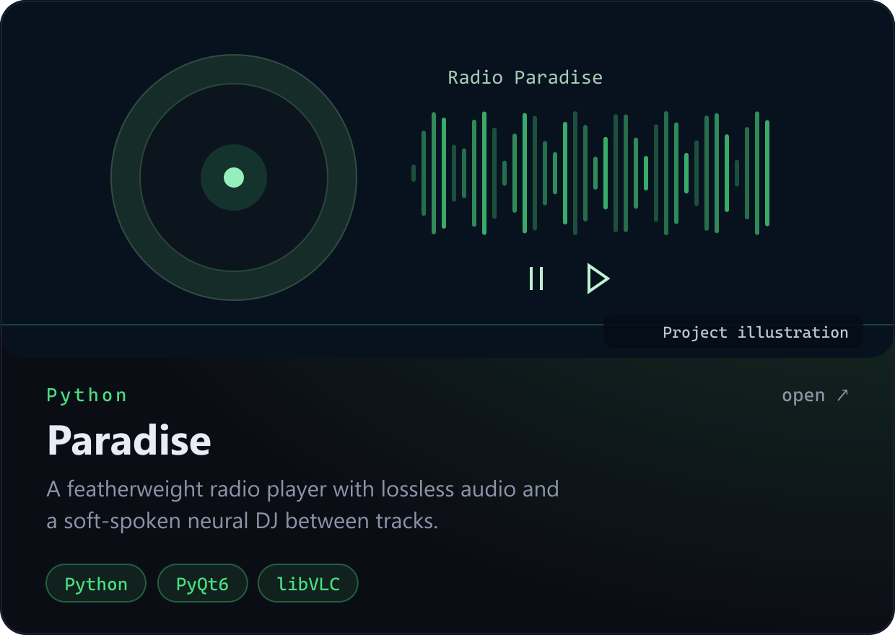</a>
  <a href="https://www.maxwellnixon.com">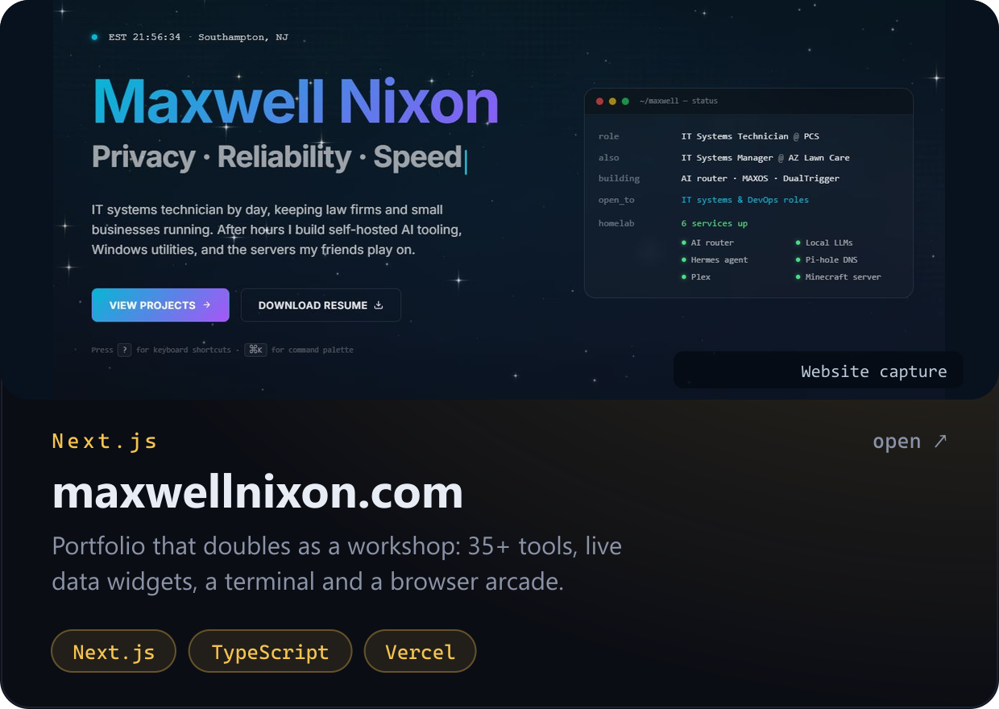</a>

## Also in the garage

- **JARVIS**, a Python voice assistant with a locally generated voice.
- **A Tesla Autopilot mod for BeamNG**, because the sim car should drive itself too.
- **Mod stacks and tooling** for RDR2, GTA IV, GTA V and Assetto Corsa, with backups and load-order management.
- **A handheld emulation setup** on a Legion Go 2, tuned emulator by emulator.
- **A sim racing and VR setup**: a Thrustmaster wheel and a Quest headset.

## Find me

[maxwellnixon.com](https://www.maxwellnixon.com) · [GitLab](https://gitlab.com/Maxwell333) · [LinkedIn](https://linkedin.com/in/maxwell-nixon-90351627a) · [mnixon112@outlook.com](mailto:mnixon112@outlook.com)

Graphics are generated from `profile.config.mjs` — `node scripts/build.mjs --profile-only`.
